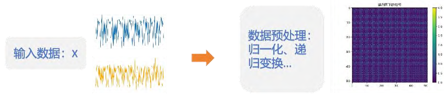
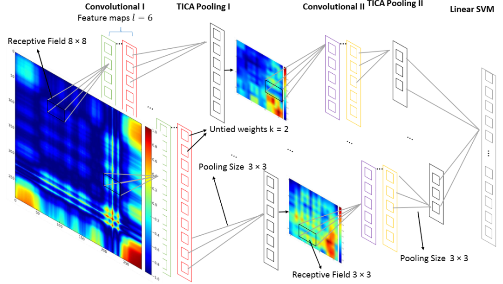
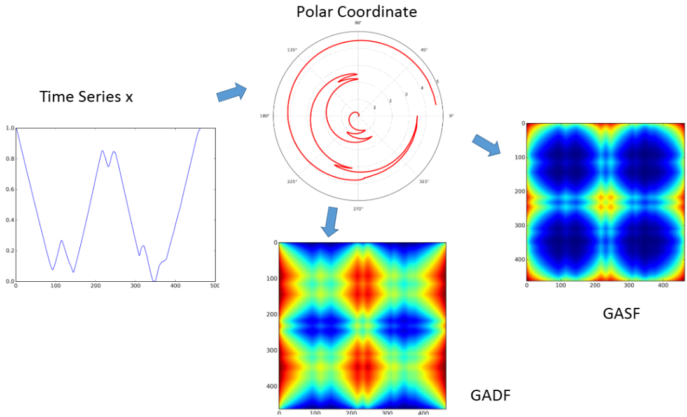
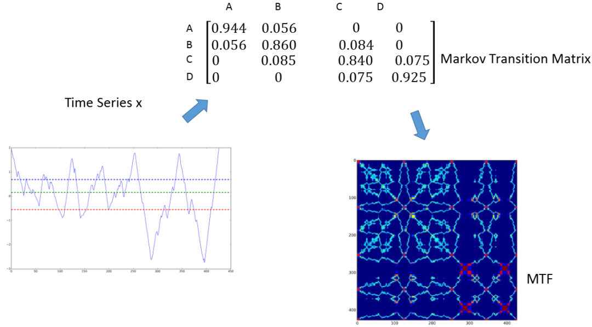
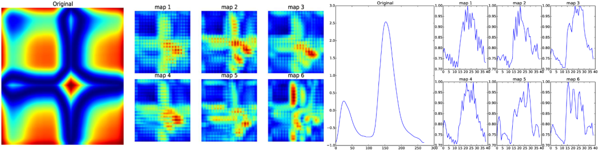

# 1D Time Series to 2D Readable Image: Gram-Schmidt Orthogonalization/Markov Chain/Recursive Graph (Matlab Code)

🌟 Why convert one-dimensional time series to two-dimensional images?
Traditional sequential analysis relies on statistical features + machine learning, but image recognition technology (such as CNN) is more powerful in feature extraction. Convert time series to two-dimensional images, which can be combined with mature algorithms in the field of computer vision to improve the accuracy of classification and anomaly detection!
Traditional one-dimensional time-series analysis has significant limitations in complex industrial fault diagnosis: transient features implicit in time-domain waveforms and state transition patterns are often difficult to effectively separate due to high noise interference and feature coupling.
Academically, transforming a one-dimensional fault signal into a two-dimensional image (similar to capturing a waveform as a photograph) is like translating complex sound waves into piano notation🎹, making it understandable even for laypeople.
This type of conversion will generate images as the input for a neural network architecture search algorithm, achieving effective identification of fault categories.
1  
Method 1: Gramian Angular Field (GAF)
🛠️ Principles (Three-Step Approach)
Pseudocode flow
Normalization: Scale the time series to [-1, 1]
Polar Transformation: Angle = arccos(Normalized Value) # Range [0, π] Radius = Timestamp Number
Construct Gram Matrix: GAF = cos(angleᵢ + angleⱼ) # Each element is the cosine of the sum of angles.
🖼️ Image characteristics
Preserve global correlation
✅ Advantages
Zero Information Loss: Theoretically reversible, capable of fully restoring the original chronological sequence.
Capture time-dependent: The change in the main diagonal direction reflects the pattern of time progression.
Compatible Image Network: Effective with ResNet and other CNN architectures (actual classification accuracy increased by +15%)
❌ Drawbacks
The computational complexity is slightly higher: O(n²) time consumption, and GPU acceleration is required for million-level data points.
Periodic interference: Strong periodic sequences may produce grid-like artifacts (need preprocessing filtering)
2  
Method 2: Markov Transition Field (MTF)
🛠️ Principle
Key Steps
Discretization: Splitting time series values into Q intervals
Calculation of transition matrix M: Mij = P(xₜ∈Interval i | xₜ₋₁∈Interval j)
Constructing MTF matrix: MTFₖₗ = Mₛₜ, where s = ceil(k·Q/n), t = ceil(l·Q/n)
For example: An MTF image of engine vibration signal, where color blocks represent the state transition probabilities.
✅ Advantages
Robustness: Insensitive to noise and outliers (preferred for financial data)
Retains dynamic features: Clearly shows state transition patterns (e.g., fault evolution paths)
Scalable: Controllable resolution through adjusting Q (commonly used between 16 and 32)
❌ Disadvantages
Window-dependent: Transition probabilities depend on window settings (need domain knowledge for tuning)
Method Three: Recurrence Plot (RP)
🛠️ Core Formula
Rᵢⱼ = Θ(ε - ||xᵢ - xⱼ||)
Set 1 when xᵢ and xⱼ are within a threshold ε distance, otherwise set 0
For example: EEG brainwave signals with recurrence plots, dotted structures reflecting neuron discharge synchrony.
✅ Advantages
Direct visualization of system state recurrence characteristics (meteorological/chaotic systems)
Efficient computation: O(n²) distance calculation (3 times faster than GAF)
Reveals hidden periodicity: Diagonal stripes reveal periodicity (a powerful tool for mechanical fault diagnosis)
❌ Disadvantages
Threshold sensitivity: ε setting requires repeated experiments (recommended to set at 10% percentile distance)

## Images

<!-- PAYMENT_BLOCK -->

## Get this dataset

- Payment link (Stripe): [Buy now](https://buy.stripe.com/3cs8yP7sY87d0vu9AB)
- Payment QR code: 

<!-- /PAYMENT_BLOCK -->
